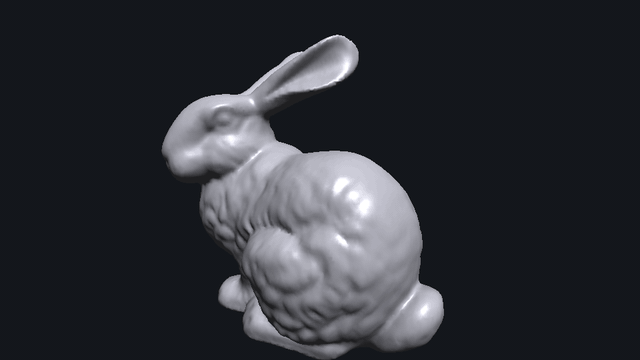
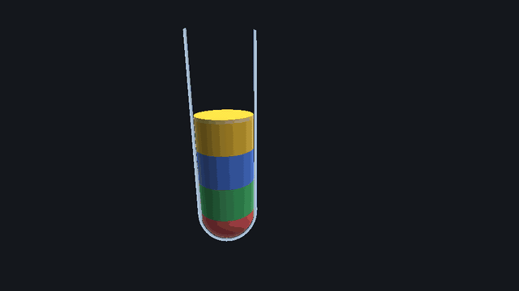
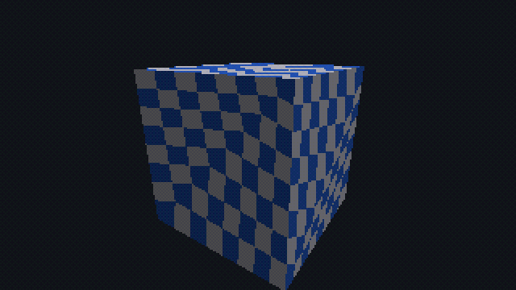
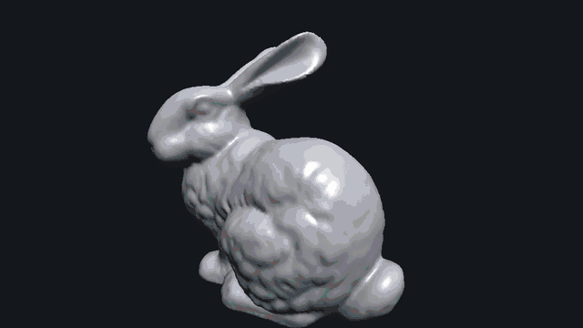

# Tessera

A real-time 3D software rasterizer written from scratch in C++17. No OpenGL, Vulkan, or Metal: every stage of the pipeline runs on the CPU. SDL2 is used only to show the finished framebuffer and read input. It also runs in the browser via WebAssembly.

**▶ [Try it in your browser](https://xenon757.github.io/tessera/)**: a small Blender-style editor on top of the renderer. Add primitives, click to select, edit them in the properties panel, undo/redo, save and open scenes, import your own `.obj` / `.fbx`, or open **Examples → Liquid tube**.

| | |
|---|---|
|  |  |
| Stanford bunny (69k triangles), per-pixel Blinn-Phong | Custom shaders: liquid that stays level and sloshes |
|  |  |
| PS1 mode: affine textures, vertex snapping, 15-bit dither | Debug views: wireframe, depth, overdraw, thread tiles |

**Highlights**

- The whole pipeline by hand: near-plane clipping, perspective-correct interpolation, a top-left fill rule (exactly one triangle owns every pixel, verified on 460k pixels), z-buffer, flat/Gouraud/Phong, bilinear textures.
- Tiled, multithreaded rasterization on a custom thread pool: **4.6×** faster on 8 cores (**6.1×** when pixel-bound), with output byte-identical at any thread count.
- An ARM NEON SIMD pixel loop, **1.6×** faster on large triangles, that produces byte-identical images to the scalar loop. The WebAssembly build matches both, byte for byte.
- A PS1 mode where every quirk (affine texturing, vertex snapping, ordering tables, 15-bit dithered color, low-res upscale) is a separate setting.
- Programmable vertex and pixel shader stages, and a Liquid Sort–style liquid demo built on them.
- A scene editor around the renderer: scene graph, a command layer with grouped undo/redo, a BMesh-style editable mesh, versioned JSON scenes, CPU ray picking, and a plain-JavaScript web UI. None of it touches the pixel loop, and rendering a scene matches drawing it directly, byte for byte.
- Loads your own models, OBJ or binary FBX, with an FBX reader and zlib decompressor written from scratch (FBX 5 through 7.7, verified against reference exports and fuzzed with 30,000 corrupted files).

## Build

Native (macOS):

```sh
brew install cmake sdl2
cmake -B build
cmake --build build -j
./build/tessera                    # windowed editor viewport, default scene (cube, light, camera)
./build/tessera path/to/model.obj  # any OBJ or binary FBX, auto-centered and scaled (or drop one on the window)
./build/tessera scene.tessera.json # a saved scene (or drop one on the window)
./build/tessera liquid             # the liquid example scene
./build/tessera_headless           # no window: benchmark + writes frame.ppm
./build/tessera_headless liquid    # the liquid demo, headless
```

`tessera_headless [model.obj] [out.ppm] [frames] [threads] [distance] [simd]` prints average frame time and triangle stats. `threads` 0 (the default) means one per core; `distance` moves the camera (default 5; smaller fills more of the screen); `simd` 0 forces the scalar pixel loop. Use it for before/after performance numbers.

WebAssembly (needs [emsdk](https://emscripten.org/docs/getting_started/downloads.html)):

```sh
source ~/emsdk/emsdk_env.sh
emcmake cmake -B build-web && cmake --build build-web
python3 -m http.server 8000 --directory build-web   # open http://localhost:8000/tessera.html
node build-web/tessera_headless.js assets/bunny.obj out.ppm   # the benchmark, in WebAssembly
```

The web build is single-threaded and uses the scalar pixel loop (no NEON in WebAssembly).

GIFs: `tools/make_gifs.sh` renders `docs/*.gif` with `tessera_record` and ffmpeg.

## Controls

Editing (web page and desktop window; on the web, shortcuts are ignored while you type in a field):

| Input | Action |
|---|---|
| Left-drag / wheel | Orbit / zoom |
| Click | Select the object under the cursor (empty space deselects) |
| Drag an arrow | Move the selection along that axis (the red, green, and blue arrows on it) |
| `G` / `R` / `S` | Move / rotate / scale the selection with the mouse. Then `X` `Y` `Z` lock a world axis, typing a number sets an exact amount (`G X 2`, `R Z 90`, `S 0.5`), click or `Enter` confirms, `Esc` or right-click cancels |
| `Ctrl/Cmd Z`, `Ctrl/Cmd Shift Z` (or `Ctrl Y` on the web) | Undo / redo |
| `X` or `Delete` | Delete the selected object |
| `Ctrl/Cmd S` | Save the scene (a download on the web, `scene.tessera.json` on the desktop) |
| `Shift A`, `F2` (web) | Open the Add menu, rename the selected object |
| `C` | Toggle looking through the active scene camera |

Rendering (viewport focused):

| Input | Action |
|---|---|
| `1`–`5` | Shaded, wireframe, depth, overdraw, thread-tile views |
| `Z` | Cycle shading: flat, Gouraud, Phong |
| `F` | Toggle texture filter: bilinear / nearest |
| `B` | Toggle back-face culling |
| `P` | Toggle PS1 / modern preset |
| `Esc` | Quit (desktop) |

On the web page, the outliner (left) selects, renames (double-click), and hides objects; the properties panel (right) edits name, transform (Euler angles in degrees), material, shader parameters, light, and camera settings, or the world colors when nothing is selected. Everything you type into one field until you leave it is a single undo step.

## Editor

The editor is layered on the renderer without changing it: it builds the same `drawMesh` calls a hand-written demo would, and a test checks that rendering a scene is byte-identical to drawing its meshes directly.

- **Scene** (`src/scene.h`): a flat list of mesh, light, and camera objects with stable ids that are never reused, transforms stored as quaternions, materials, an optional custom shader with parameters, and animation tracks (stored now, played in Phase 2). Meshes live in a store keyed by id and are immutable once added, so many objects (and every undo step) can share one.
- **Editable mesh** (`src/edit_mesh.h`): a BMesh-style structure (vertices, edges, face corners, faces, linked by disk and radial cycles) that handles n-gons and non-manifold geometry and keeps per-corner UVs and normals. It triangulates into the renderer's `Mesh`, with angle-weighted smooth normals. Primitives (cube, UV sphere, cylinder, cone, plane) are generated as edit meshes, and imported models convert into one.
- **Commands** (`src/commands.h`): every change is a JSON command (`{"op":"setTransform","id":1,"position":[0,1,0]}`) that is validated first and then applied, and it records the exact inverse. Undo replays inverses, and commands can be grouped into one step (a drag, a field edit). The UI, the desktop window, and (in Phase 4) an AI assistant all edit the scene through this one door. Selection and the viewport camera are UI state, outside the history.
- **Files** (`src/json.h`): a strict JSON reader and writer (written for this, no library). Scenes save as `"format": "tessera-scene", "version": 1`. Primitives are saved as their settings and rebuilt on load, other meshes as flat arrays. Loading is all-or-nothing: a bad file leaves the current scene untouched.
- **Grab / rotate / scale** (`src/transform_tool.h`): Blender's modal G/R/S. A free move slides the object across the plane through it that faces the camera; a move locked to an axis follows the point on that axis closest to the mouse ray. Rotation follows the mouse's angle around the object on screen, and scale its distance. Every mouse move replaces the previous one inside an open undo group, so confirming leaves exactly one undo step and cancelling leaves none.
- **Move gizmo** (`src/gizmo.h`): three arrows on the selection that stay 120 px long on screen at any distance. At depth d, a perspective camera sees 2·d·tan(fov/2) world units across its height, which gives the world size of a pixel. Hovering is tested in screen pixels (distance to each projected arrow), and dragging one starts the same axis-locked grab as `G` then `X`.
- **Picking** (`src/picking.h`): a click un-projects a ray through the inverse view-projection matrix and tests it on the CPU, only when you click. The ray is moved into each object's local space, rejected early against the bounding box (slab test), then tested against triangles (Möller–Trumbore). Lights and cameras are picked by small spheres around their gizmos.
- **Web UI** (`web/editor.js`): plain JavaScript, no framework or build step. It calls exported C functions (`tessera_command`, `tessera_undo`, `tessera_state`, …) that take and return JSON, and polls a revision counter each frame to know when to redraw the panels.

## Tests

```sh
cmake -B build && cmake --build build -j && (cd build && ctest)
cmake -B build-asan -DTESSERA_SANITIZE=ON && cmake --build build-asan -j && (cd build-asan && ctest)   # ASan + UBSan
```

12 tests: golden-image hashes for the renderer (scalar, NEON, and threaded output must match), the zlib decoder (plus a generated corpus) and FBX/OBJ loaders (plus generated FBX files), math (quaternions, Euler angles, matrix inverse), the edit mesh, JSON, scene save/load, every command and its undo, picking, and the editor session. CI runs both builds on every push.

## Architecture

```
drawMesh
  geometry pass (parallel over mesh chunks):  vertex ─► clip ─► project ─► cull ─► bin into screen tiles
  raster pass   (parallel over tiles):        edge functions ─► depth test ─► shade
                                              (scalar, or ARM NEON 4 pixels at a time)
endFrame: debug views, color reduction
                          everything reads RenderSettings
```

The pixel loop has two implementations: a scalar reference, and an ARM NEON version that processes 4 pixels per instruction. Floating-point contraction is disabled (`-ffp-contract=off`) so both do identical IEEE operations, and the NEON loop is tested to produce byte-identical images. That also makes it safe to pick a loop per triangle: triangles narrower than 8 pixels stay scalar, where 4-wide groups would mostly waste lanes. The WebAssembly build uses the scalar loop.

A draw can also pass a `Shader` (`src/shader.h`) that replaces the fixed-function vertex and pixel stages, like GPU shaders: `vertex()` outputs a clip-space position plus attributes (including 4 free "custom" floats), and `pixel()` returns a color or discards the pixel. Clipping, culling, the fill rule, and the depth test stay fixed. Custom shaders run on the scalar pixel loop.

Both passes run on a small thread pool. Tiles never overlap, so raster threads need no locks, and each tile draws its triangles in submission order, which keeps the output byte-identical at any thread count.

| File | Role |
|---|---|
| `src/render_settings.h` | Every pipeline knob, plus the `modern()` and `ps1()` presets |
| `src/renderer.{h,cpp}` | The pipeline stages, including the scalar pixel loop |
| `src/raster_neon.cpp`, `src/raster.h` | The NEON pixel loop, and the edge/setup types it shares with the scalar loop |
| `src/framebuffer.{h,cpp}` | Color, depth, and overdraw buffers (ARGB8888, uploads to SDL with no conversion) |
| `src/mesh.{h,cpp}` | OBJ loader (v/vt/vn, n-gons, negative indices, smooth normals), `loadModel` (OBJ or FBX by extension), procedural cube and tube |
| `src/fbx.{h,cpp}` | Binary FBX reader: node tree, meshes (normals/UVs in every mapping mode), transforms and hierarchy, axis systems |
| `src/inflate.{h,cpp}` | zlib/DEFLATE decompressor (binary FBX compresses its arrays) |
| `src/texture.{h,cpp}` | Textures: procedural checkerboard, nearest and bilinear sampling |
| `src/thread_pool.{h,cpp}` | Persistent worker threads with a `parallelFor` |
| `src/shader.h` | The programmable `Shader` interface, `ClipVertex`, `PixelInput` |
| `src/liquid.{h,cpp}`, `src/liquid_scene.h` | Liquid and glass shaders, slosh simulation, and the demo scene |
| `src/vecmath.h` | Vec2/3/4, Mat4, perspective, lookAt |
| `src/camera.h` | Orbit camera |
| `src/main_sdl.cpp` | Windowed front end (also the WebAssembly entry point) |
| `src/main_headless.cpp` | Benchmark / image-output front end (also builds for WebAssembly + Node) |
| `src/main_record.cpp`, `tools/make_gifs.sh` | Renders the README GIFs |
| `src/scene.{h,cpp}` | Scene graph: objects, transforms, materials, lights, cameras, mesh store, JSON save/load |
| `src/commands.{h,cpp}` | The command layer: validated, invertible JSON commands; undo/redo with groups |
| `src/edit_mesh.{h,cpp}` | BMesh-style editable mesh, triangulation to a render `Mesh` |
| `src/primitives.{h,cpp}` | Cube, UV sphere, cylinder, cone, plane |
| `src/json.{h,cpp}` | JSON reader/writer |
| `src/scene_render.{h,cpp}` | Draws a scene with the renderer, plus grid, gizmos, and selection overlays |
| `src/picking.{h,cpp}` | Click-to-select by CPU ray casting |
| `src/transform_tool.{h,cpp}` | The G/R/S tool's math: mouse movement to a new transform |
| `src/gizmo.{h,cpp}` | The move gizmo: constant-size arrows, hit testing, drawing |
| `src/editor.{h,cpp}` | The editor session both front ends drive: scene, history, selection, viewport |
| `web/shell.html`, `web/editor.js` | The web editor page: toolbar, outliner, properties panel |
| `tests/` | The CTest suite (see Tests) |

## Loading models

Drop a `.obj` or `.fbx` on the desktop window, or use the web page's **File → Import model** (or drop the file on the canvas). The model becomes a new object, centered and scaled to fit, and the import can be undone. On the web, the page copies the file into Emscripten's in-memory filesystem and calls the C++ loader through an exported function.

The FBX reader is written from scratch, including its zlib decompressor:

- **Format:** a binary FBX is a tree of nodes with typed properties; big arrays are zlib-compressed. Versions 5 through 7.7 lay meshes and transforms out differently, so meshes are found structurally (any node with vertices and polygons) rather than per version.
- **Meshes:** polygons (a negative index ends each one) are fan-triangulated; normals and UVs are read in every mapping mode (per corner, per vertex, per polygon, indexed or direct); meshes without normals get smooth ones.
- **Transforms:** the FBX SDK's full local transform (translation, pre/post rotation, all six rotation orders, pivots, offsets, scaling), the parent hierarchy, 3ds Max's geometric offset, and the file's axis system, so Z-up files stand up. Normals use the inverse-transpose; mirrored transforms flip the winding.
- **Verified** against reference OBJ exports of the same scenes from [ufbx](https://github.com/ufbx/ufbx)'s test corpus (Blender, Maya, 3ds Max; FBX 5 to 7.7): every vertex matches to within float rounding. Fuzzed with 30,000 corrupted files under AddressSanitizer/UBSan (which caught two unchecked sizes, now fixed); the zlib decoder separately matches Python's zlib on 2,457 streams covering every block type.
- **Not supported:** ASCII FBX and big-endian files (clear error messages), materials and textures, animation.

## Liquid demo

Open **Examples → Liquid tube** (or run `tessera liquid` / `tessera_headless liquid`) for a Liquid Sort–style test tube. Move or rotate the Liquid object and it sloshes; its fill level and foam are shader parameters in the properties panel. It's two custom shaders on two procedural tubes, with no liquid geometry:

- **Liquid** (`LiquidShader`): the vertex stage stores each vertex's height above the tube's center along the surface normal; the pixel stage discards everything above the fill level. Because that plane is in world space, the surface stays level however the tube tilts. Front faces get colored layers and a foam line. Back faces show only where the front was cut away, so they're drawn flat as the liquid's top surface. That is what makes a hollow tube look filled.
- **Slosh** (`LiquidWobble`): in an accelerating container the surface settles perpendicular to effective gravity, so its tilt targets acceleration / g. A damped spring per axis chases that target, so the liquid overshoots and settles. Acceleration comes from finite differences of a point at the top of the tube, so tilting sloshes it too.
- **Glass** (`GlassShader`): there's no alpha blending, so the glass discards itself wherever it faces the camera and draws only the grazing-angle rim (the Fresnel effect) and a specular streak.

## PS1 mode

Press `P` to switch to `RenderSettings::ps1()`. Every PS1 quirk is a separate setting, so each can be turned on alone.

| Setting | What the PS1 did | What you see |
|---|---|---|
| `textureMapping = Affine` | No per-pixel divide: UVs interpolated linearly in screen space | Textures kink along polygon diagonals and swim as the camera moves |
| `vertexSnap` | The GTE output whole-pixel screen coordinates | Vertices jitter a pixel at a time; slivers collapse |
| `depthMode = OrderingTable` | No depth buffer: triangles bucketed by average depth, drawn far to near | Overlapping polygons at similar depths pop through each other |
| `colorDepth = Bits15`, `dither` | 5 bits per channel, hidden with the GPU's 4×4 ordered-dither matrix | Fine crosshatch texture instead of banding |
| `internalScale = 3` | ~320×240 output, blown up by the TV | Chunky pixels (here 320×180, upscaled 3× with nearest neighbor) |
| `textureFilter = Nearest`, `shading = Gouraud` | No texture filtering; lighting per vertex | Blocky texels; soft, low-detail lighting |

Simplification: the dither is applied to the whole frame, including the background; the PS1 dithered only shaded polygons.

## Roadmap

- [x] **Day 1:** Filled-triangle rasterizer (barycentric/edge functions), z-buffer, flat Lambert shading
- [x] **Day 2:** Near-plane clipping, perspective-correct UVs, texture sampling, Gouraud + Phong
- [x] **Day 3:** Depth/overdraw/thread-tile debug views; top-left fill rule; tiled, multithreaded rasterization
- [x] **Day 4:** PS1 mode: affine texturing, vertex snapping, ordering tables, 15-bit color + dithering, low-res upscale
- [x] **Day 5:** ARM NEON SIMD inner loop (scalar fallback kept for WASM)
- [x] **Day 6:** Programmable vertex/pixel stages; Liquid Sort–style liquid shader
- [x] **Day 7:** WebAssembly build (`emcmake cmake -B build-web && cmake --build build-web`), GIFs, perf table

Then, an online editor:

- [x] **Phase 1:** Scene graph, commands with undo/redo, editable mesh, JSON scenes, primitives, click-to-select, web UI
- [ ] **Phase 2:** Keyframe animation
- [ ] **Phase 3:** Export
- [ ] **Phase 4:** AI chat that edits the scene through commands
- [ ] **Phase 5:** Modeling tools

## Performance

Every row was measured in one session with `tessera_headless <model> out.ppm <frames> <threads> [distance] [simd]` at 960×540: 5 interleaved rounds, median, RelWithDebInfo, Apple M1 Pro (8 performance + 2 efficiency cores). Older rows come from rebuilding that commit with the same flags (including `-falign-functions=64`, see notes). Single-thread rows vary by under 4% between runs; 8-thread rows by 5–10%, because other apps were using some of the cores.

Model: Stanford bunny (69,451 triangles) unless noted. The "cube close-up" is the textured, Phong-lit cube at camera distance 2.4: a few big triangles, so nearly all of its time is per-pixel work.

| Change | Frame time | Speedup |
|---|---|---|
| Day 1 baseline: scalar edge functions, z-buffer, flat Lambert, 1 thread | 4.44 ms | 1.00× |
| Day 2 features: per-pixel Phong + Blinn-Phong specular, textures (a cost, not an optimization) | 5.18 ms | 0.86× |
| Geometry pass + 64 px tile bins + raster pass, still 1 thread | 5.34 ms | 0.97× |
| Thread pool: both passes in parallel, 1 → 8 threads | 5.38 → 1.16 ms | **4.6×** |
| Same, camera close-up (`distance` 2.2, raster-heavy), 1 → 8 threads | 10.26 → 1.68 ms | **6.1×** |
| `-ffp-contract=off` for bit-identical scalar/SIMD output (a cost), 1 thread | 5.44 → 5.69 ms | 0.96× |
| NEON pixel loop, cube close-up, 1 thread | 11.98 → 7.61 ms | **1.57×** |
| NEON pixel loop, cube close-up, 8 threads | 1.74 → 1.15 ms | **1.51×** |
| NEON pixel loop, bunny (triangles under 8 px wide stay scalar), 1 thread | 5.84 → 5.85 ms | 1.00× |
| Day 6: programmable shaders; 4 custom floats per vertex (a cost: bigger vertices to bin), 1 thread | 5.77 → 5.96 ms | 0.97× |
| Day 7: WebAssembly (Node 24 / V8) vs. native, scalar, 1 thread, bunny | 6.19 → 8.90 ms | 0.70× |
| Day 7: WebAssembly vs. native, scalar, 1 thread, cube close-up | 12.04 → 16.68 ms | 0.72× |
| **Today vs. Day 1:** bunny, 8 threads, NEON, with all Day 2–5 features | 4.44 → 1.21 ms | **3.7×** |

Notes:
- A profile of the single-threaded frame (macOS `sample`) showed ~60% in rasterization and ~37% in the geometry stages, so both passes run in parallel. Threading only the raster pass would cap the speedup under 3× (Amdahl's law).
- 10 threads is no faster than 8: the last two are the M1 Pro's efficiency cores. 64 px tiles beat 16, 32 (binning overhead) and 128 (too few busy tiles to share out).
- The NEON loop gets 1.6×, not 4×, because `pow` (specular) and texture fetches still run one lane at a time. The bunny gains nothing: its triangles are ~3 px, so its time goes to geometry and per-triangle setup, which SIMD here doesn't touch.
- WebAssembly runs at ~70% of native single-thread speed with no SIMD or threads, and its frames are byte-identical to the native ones (bunny, cube, and liquid demo checked).
- A Day 6 refactor slowed the scalar loop 19% on pixel-heavy scenes: copying `baseColor` into a local `Vec3` pinned three more registers for the whole loop, and the Phong + texture path started spilling. My checks at the time only timed the bunny (tiny triangles) and the NEON path, so it slipped through until the Day 7 re-measure; reading it through a reference fixed it.
- Code layout skews results. Before `-falign-functions=64`, editing one function shifted where untouched hot functions landed, moving their speed by ±10% (one profile showed `Texture::sampleBilinear`, unchanged, running 38% slower). Every row here uses the flag.

## Credits

`assets/bunny.obj`: the Stanford Bunny, from the [Stanford 3D Scanning Repository](https://graphics.stanford.edu/data/3Dscanrep/) (OBJ via [alecjacobson/common-3d-test-models](https://github.com/alecjacobson/common-3d-test-models)).
